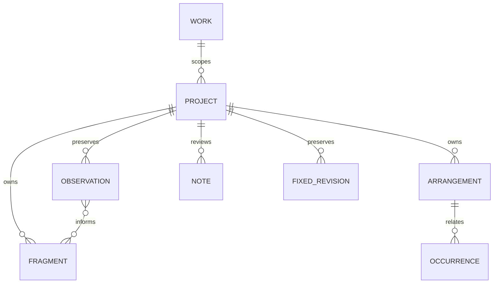

# 领域与本体设计

## 专业聚合

Evidence固定引文、Observation原始观察、Motif意象、Fragment写作片段、Arrangement篇章编排、Occurrence独立出场、Variant片段备选、Note固定意见。根字段：evidence、observations、motifs、fragments、arrangements、variants、notes、basis_refs。专业对象以WorkRef＋owner_plugin_id＋object_id确定身份，revision＋sha256固定内容。相同标题不代表同一对象。

原始引文和观察只追加；事实观察、记忆、虚构和借用是提交者声明，不是软件认证。片段固定其观察组合摘要，编排固定片段及独立出场次序的组合摘要。同一片段可以多次出场，但每次出场有独立ID和顺序，不按内容去重。改片段后旧编排、意见和备选明确待复核。新建或改变依据时必须匹配当前摘要，沿原基线未改的旧记录允许保持过期；不能用整本保存绕过快照核验。备选应用固定完整片段摘要，保留其他片段原字节，正文采纳另行决定。

所有集合ID唯一、所有引用存在、集合有界、顺序在对应父级唯一。撤销先处理依赖，不能制造悬空引用；来源索引只追加，整本保存不能改变原索引意义。跨包引用只携带固定Owner、对象、修订与摘要，通过公开SDK回读，不导入对方私有结构。

## 权属

原始资料、作品身份与受管事务归Core；专业记录归本包；理解、创作与解释归作者选择的外部Agent；表达取舍与定稿归作者。借助欧卡姆原理复用通用事实，只增加本旅程需要的专业状态。
